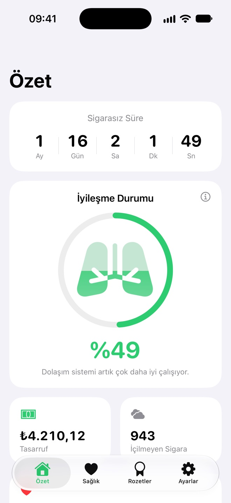
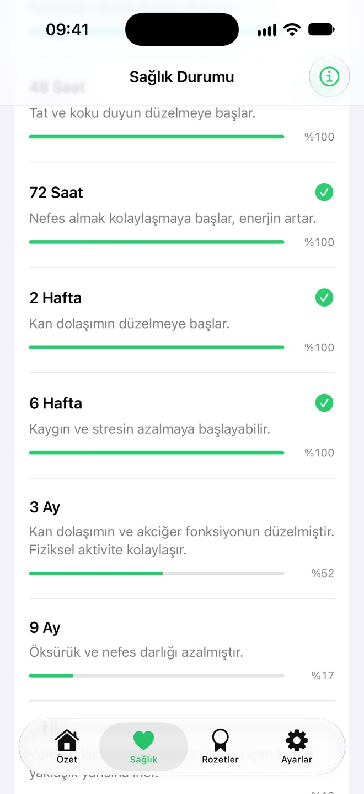
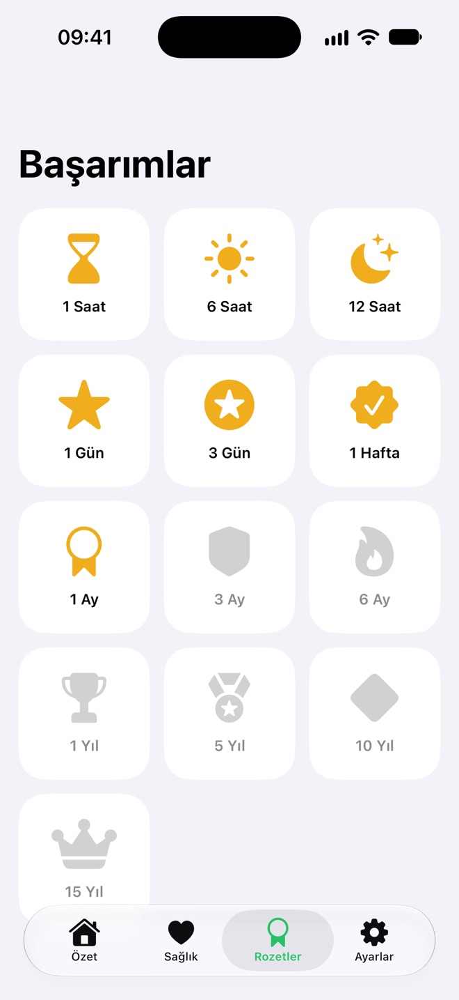
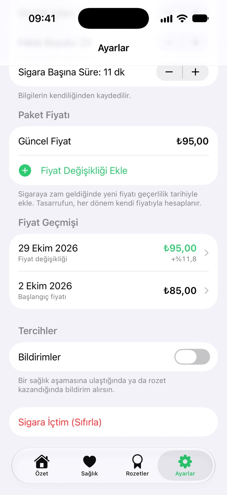
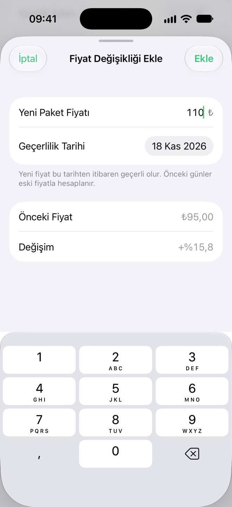

# 🫁 BreathNew - Sigarayı Bırakma Takipçisi - iOS


**BreathNew**, sigarayı bırakan birinin sigarasız geçen süreyi, biriken tasarrufu ve sağlığındaki değişimi tek ekranda izlemesi için yapılmış bir iOS uygulamasıdır. Hesap açmak gerekmez, internet bağlantısı istemez, reklam göstermez; girilen her bilgi yalnızca cihazda kalır. Türkçe ve İngilizce kullanılabilir.

---

## ✨ Öne Çıkan Özellikler

* ⏱ **Sigarasız süre:** Bırakma anından bu yana geçen süre saniye saniye sayılır. Henüz dolmamış birimler (yıl, ay, gün) gizlenir, sayaç sade kalır.
* 🫁 **İyileşme halkası:** Sigarasız ilk yıldaki ilerleme, dolan bir halka ve nefes alıp veren bir akciğerle gösterilir. Altındaki mesaj, bulunulan döneme göre değişir.
* 💰 **Tasarruf ve kazanımlar:** Biriken para, içilmeyen sigara sayısı ve geri kazanılan süre. Geri kazanılan süre, sigara başına girilen dakikadan hesaplanır.
* 📈 **Zam takibi:** Sigaraya zam geldiğinde yeni fiyat, geçerlilik tarihiyle eklenir. Tasarruf her dönem kendi fiyatıyla hesaplanır; zamdan önceki günler eski fiyatla kalır.
  * İleri tarihli zam girilebilir; günü gelene kadar hesaba katılmaz.
  * Aynı güne ikinci kez girilen fiyat, yeni kayıt açmak yerine o günü günceller.
  * Geçmişte her kaydın yanında bir öncekine göre yüzde değişim görünür.
* ❤️ **Sağlık çizelgesi:** 20 dakikadan 15 yıla uzanan 13 aşama, her biri kendi ilerleme çubuğuyla. Metinler Dünya Sağlık Örgütü, CDC ve NHS'in yayımladığı bilgilere dayanır; kaynak bağlantıları uygulamanın içindedir.
* 🏅 **Rozetler:** 1 saatten 15 yıla 13 rozet. Kazanılanlar altın rengine döner.
* 🔔 **Bildirimler:** İsteğe bağlıdır. Açıldığında her sağlık aşamasında ve her rozette bir bildirim gelir; bırakma tarihi ya da dil değişince bildirimler yeniden kurulur.
* 🌍 **Dil ve para birimi:** Dil uygulamanın içinden değiştirilir (Türkçe, İngilizce). Para birimi olarak TL, dolar, euro ve sterlin seçilebilir.
* 🔄 **Yeniden başlama:** "Sigara İçtim" seçeneği bırakma tarihini o ana çeker; güncel fiyat korunur.
* 🔒 **Gizlilik:** Veri toplanmaz, sunucuya gönderilmez, izleme yapılmaz.
* ♿ **Erişilebilirlik:** Açık ve koyu temaya uyar, kartlar VoiceOver için tek öğe olarak okunur, "Hareketi Azalt" açıkken nefes animasyonu durur.

---

## 📸 Ekran Görüntüleri

| Özet | Sağlık | Rozetler |
|:---:|:---:|:---:|
|  |  |  |
| Sigarasız süre, iyileşme halkası ve altında tasarruf ile içilmeyen sigara sayısı. | Tamamlanan aşamalar işaretli, sıradakiler yüzdesiyle. Sağ üstteki düğme kaynakları açar. | 47. günde yedi rozet kazanılmış, altısı bekliyor. |

| Fiyat Geçmişi | Zam Ekleme |
|:---:|:---:|
|  |  |
| Güncel fiyat, başlangıç fiyatı ve aradaki zam. Geçerli fiyat yeşil, yanında yüzde değişim. | Yeni fiyat yazılırken önceki fiyat ve değişim oranı altında görünür. |

---

## 🩺 Sağlık Bilgileri Hakkında

BreathNew tıbbi bir cihaz değildir ve tıbbi tavsiye vermez. Özet ekranındaki yüzde, sigarasız ilk yıldaki ilerlemeyi gösteren bir tahmindir; akciğerlerin ya da sağlığın ölçümü değildir. Çizelgedeki aşamalar ortalama değişimlerdir ve kişiden kişiye farklılık gösterir.

Aşamaların dayandığı kaynaklar:

* [Dünya Sağlık Örgütü — Tobacco: Health benefits of smoking cessation](https://www.who.int/news-room/questions-and-answers/item/tobacco-health-benefits-of-smoking-cessation)
* [CDC — Benefits of Quitting Smoking](https://www.cdc.gov/tobacco/about/benefits-of-quitting.html)
* [NHS — Benefits of quitting smoking](https://www.nhs.uk/better-health/quit-smoking/benefits-of-quitting-smoking/)

---

## 🛠 Teknik Detaylar & Mimari

* **Mimari:** MVVM. Her ekranın kendi görünüm modeli vardır; veri tek bir `DataManager` üzerinden okunur ve yazılır.
* **Arayüz:** Tamamı SwiftUI. Renkler ve kart stili `Extensions/Color+Ext.swift` içinde tanımlıdır; arka planlar sistem renklerinden gelir, bu yüzden koyu temada ayrıca ayar gerekmez.
* **Veri:** Kullanıcı bilgisi (`UserData`) JSON olarak `UserDefaults`'ta saklanır. Ağ katmanı yoktur.
* **Tasarruf hesabı:** `UserData.moneySaved(until:)` fiyat geçmişini dönemlere böler ve her dönemi kendi fiyatıyla toplar. Bir andaki fiyat, o andan önceki son kayıttır.
* **Fiyat girişi:** `View/PriceField.swift` yazıldıkça değeri günceller, virgül ve noktayı kabul eder, para birimi simgesini alanın dışında tutar.
* **Bildirimler:** `Managers/NotificationManager.swift`, `UNUserNotificationCenter` ile yerel bildirim kurar. Aynı ana denk gelen sağlık aşaması ve rozet tek bildirimde birleşir.
* **Yerelleştirme:** String Catalog (`Localizable.xcstrings`). Dil, sistem dilinden bağımsız olarak uygulama içinden seçilir.
* **Gizlilik bildirimi:** `PrivacyInfo.xcprivacy`, `UserDefaults` kullanımını beyan eder; toplanan veri türü yoktur.
* **Hedef:** iOS 26 ve üstü, yalnızca iPhone, dikey kullanım.
* **Klasörler:** Güncel uygulama `BreathNew/` altındaki Xcode projesidir. `Sources/` ve `Tests/` klasörleri uygulamanın eski bir Swift Package kopyasıdır.

---

## 🚀 Kurulum & Çalıştırma

Projeyi kendi ortamınızda incelemek veya geliştirmek için aşağıdaki adımları izleyebilirsiniz:

1.  Bu depoyu bilgisayarınıza klonlayın:
    ```bash
    git clone https://github.com/aliyakarr9/BreathNewV2-iOS.git
    ```
2.  İndirdiğiniz klasördeki `BreathNew/BreathNew.xcodeproj` dosyasını çift tıklayarak **Xcode** (26 veya üstü) üzerinde açın.
3.  Üst menüden bir **iPhone simülatörü** veya bilgisayarınıza bağlı gerçek bir **iPhone** seçin.
4.  `Cmd + R` tuş kombinasyonuna basarak (veya Play butonuna tıklayarak) projeyi derleyip çalıştırın.

---

## 🤝 Katkıda Bulunma

Yeni bir dil eklemek, sağlık çizelgesini güncel kaynaklarla genişletmek veya mevcut bir hatayı düzeltmek isterseniz:
1. Projeyi *fork* edin.
2. Yeni bir dal (branch) oluşturun (`git checkout -b feature/yeni-ozellik`).
3. Değişikliklerinizi commit edin (`git commit -m 'Yeni özellik eklendi'`).
4. Dalınıza (branch) push yapın (`git push origin feature/yeni-ozellik`).
5. Bir Pull Request (PR) oluşturun.

---

👨‍💻 **Geliştiren & Tasarlayan:** [Ali Yakar](https://github.com/aliyakarr9)  
📧 İletişim, işbirlikleri ve geri bildirim için GitHub üzerinden bana ulaşabilirsiniz.


